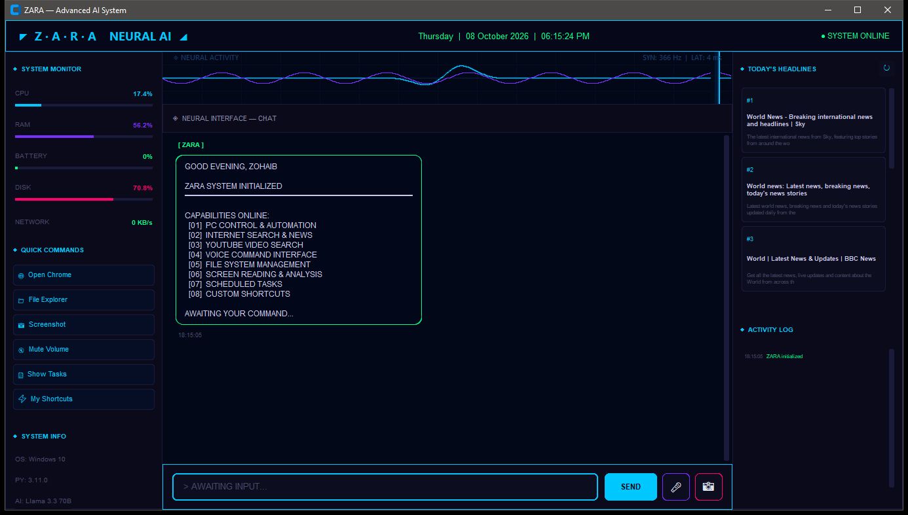
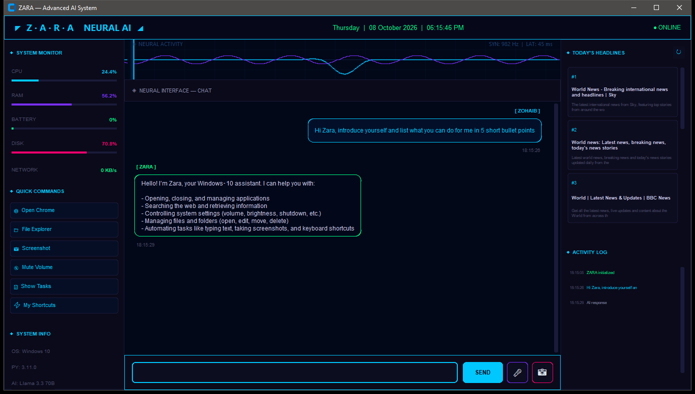
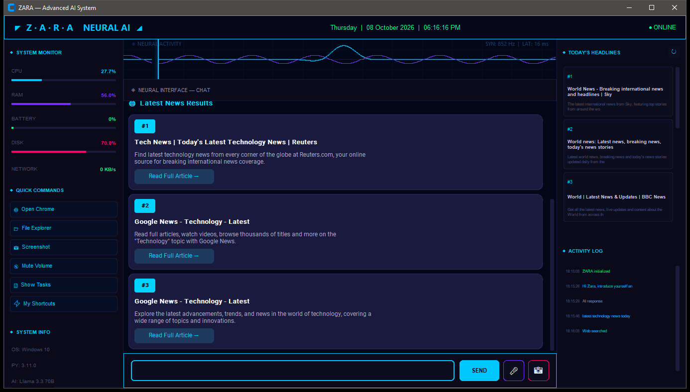
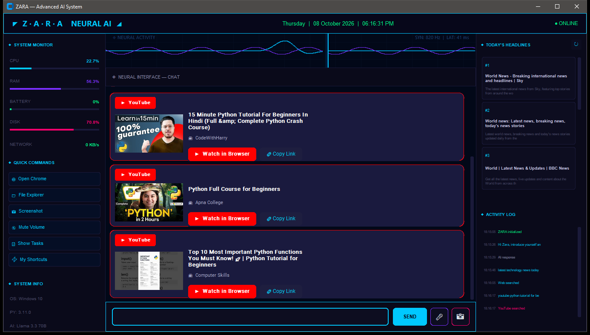
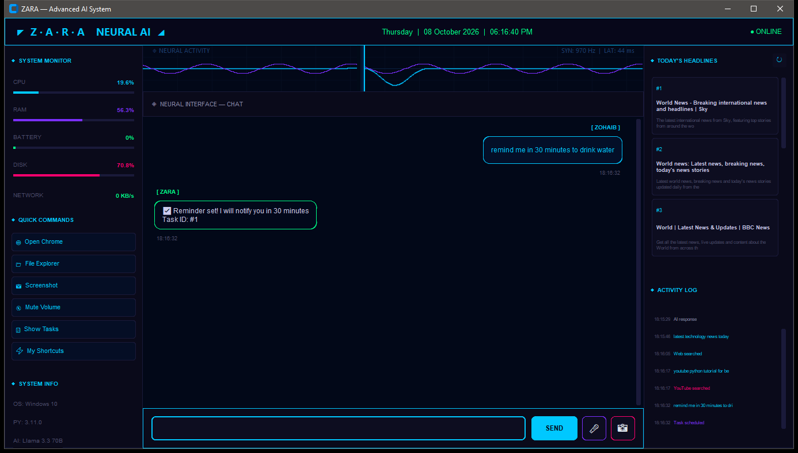

# ZARA — Neural AI Desktop Assistant

ZARA is an AI-powered desktop assistant for Windows 10 with a futuristic, sci-fi style interface.
It understands natural language (typed or spoken) and can chat, search the web, find YouTube videos,
control your PC, read your screen, schedule reminders and run custom shortcuts.

## Screenshots

### Dashboard (Home)
Live system monitor (CPU, RAM, battery, disk, network), quick commands, today's headlines and activity log.



### AI Chat
> "Hi Zara, introduce yourself and list what you can do for me in 5 short bullet points"



### Web & News Search
> "latest technology news today"



### YouTube Search
> "youtube python tutorial for beginners"



### Task Scheduler / Reminders
> "remind me in 30 minutes to drink water"



## Features

1. **PC Control & Automation** — open/close apps, volume, brightness, shutdown, typing, key presses, minimize all
2. **Internet Search & News** — live web results with source cards
3. **YouTube Video Search** — video cards with thumbnails, "Watch in Browser" and "Copy Link"
4. **Voice Command Interface** — speech recognition + text-to-speech replies
5. **File System Management** — open and manage files and folders
6. **Screen Reading & Analysis** — capture the screen and let the AI describe it
7. **Scheduled Tasks** — reminders and recurring tasks
8. **Custom Shortcuts** — chain multiple commands under one name

## Tech Stack

- Python 3.11
- [CustomTkinter](https://github.com/TomSchimansky/CustomTkinter) — GUI
- [Groq](https://groq.com) — LLM inference
- DDGS (DuckDuckGo Search) — web search
- YouTube Data API v3 — video search
- SpeechRecognition, pyttsx3, edge-tts — voice
- psutil, pyautogui, pycaw, screen-brightness-control — system control
- pytesseract — screen text reading

## Project Structure

| File | Purpose |
|------|---------|
| `main.py` | Main GUI application (entry point) |
| `ai_brain.py` | Talks to the LLM and keeps conversation history |
| `pc_control.py` | Executes PC commands returned by the AI |
| `internet.py` | Web search, article reading and YouTube search |
| `voice.py` | Speech-to-text and text-to-speech |
| `screen_reader.py` | Screenshot capture and AI screen analysis |
| `scheduler.py` | Reminders and scheduled tasks |
| `shortcuts.py` | Custom multi-step shortcuts |
| `ui_cards.py` | News and YouTube result cards |
| `config.example.py` | Configuration template |

## Installation

```bash
git clone https://github.com/ahmadbajwa9932-netizen/Zara.git
cd Zara
python -m venv venv
venv\Scripts\activate
pip install -r requirements.txt
```

Then create your config file:

```bash
copy config.example.py config.py
```

Open `config.py` and add your **Groq API key** and **YouTube Data API key**.

> For screen reading, install [Tesseract OCR](https://github.com/UB-Mannheim/tesseract/wiki).

## Run

```bash
python main.py
```

## Example Commands

- `open chrome`
- `set volume to 50`
- `take screenshot`
- `latest technology news today`
- `youtube python tutorial for beginners`
- `remind me in 30 minutes to drink water`
- `show my tasks`
- `show shortcuts`

## Author

**Zohaib Amjad**
